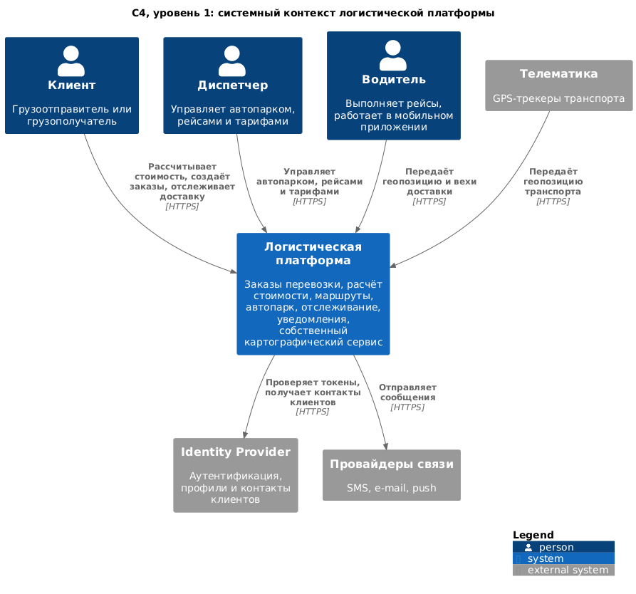
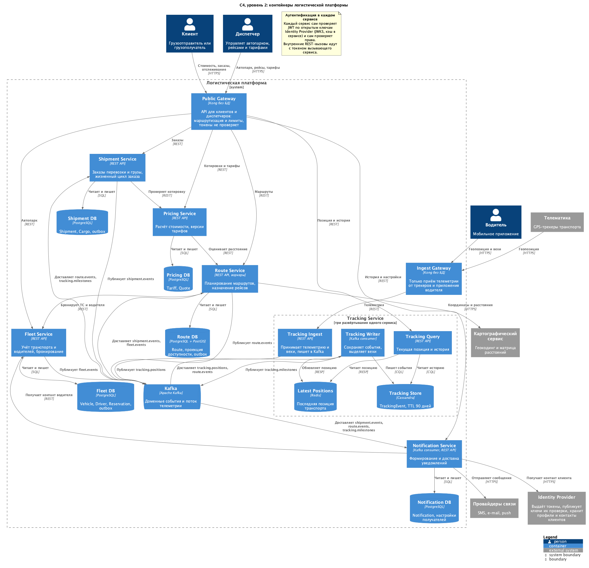
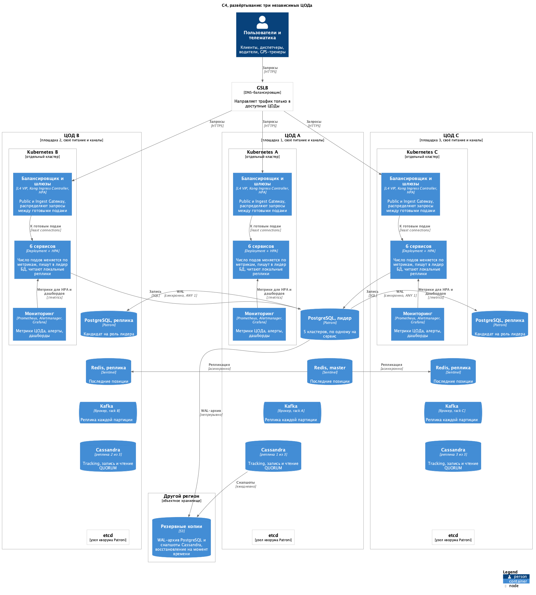

# ADR-001. Декомпозиция по bounded contexts на шесть сервисов

**Статус:** принято
**Дата:** 2026-11-01

## Контекст проблем

Монолит логистической платформы нужно разделить так, чтобы выполнялись ограничения варианта 2226: независимое масштабирование, доступность критичных операций 24/7, явное владение данными, возможность выделить новый сервис, работа пяти команд при 5 000 RPS.

Единое приложение мешает выполнить их по следующим причинам:

- **Нагрузка неравномерна.** По оценке из [отчёта](README.md#1-исходные-данные-и-допущения), Tracking получает около 80 % запросов, а создание заказов даёт всего около 12 RPS в пик. Масштабировать приходится всё приложение целиком.
- **Сбои не изолированы.** Ошибка в расчёте маршрутов или всплеск телеметрии может остановить приём заказов.
- **Данные без владельца.** Общая БД позволяет любому модулю менять чужие таблицы, а изменение схемы приходится согласовывать между всеми.
- **Общий цикл релизов.** Пять команд зависят от одного развёртывания.

Нужно решить, по каким границам делить систему и сколько сервисов создать.

## Рассмотренные альтернативы

### Альтернатива A. Сервис на сущность

Восемь сервисов: Shipment, Cargo, Vehicle, Driver, Route, Tracking, Tariff, Notification.

Границы очевидны и каждую сущность можно масштабировать отдельно. Но создание заказа с грузом становится распределённой транзакцией, а бронирование транспорта и водителя теряет атомарность. Восемь сервисов на пять команд означают, что часть команд будет вести по два сервиса с сильно связанными моделями. Цепочка синхронных вызовов тоже снижает доступность: при 99,9 % у каждого из трёх сервисов получается 0,999³ ≈ 99,7 %, то есть около 26 часов простоя в год вместо 9.

### Альтернатива B. Модульный монолит и отдельный Tracking

Две единицы развёртывания: монолит с модулями Shipment, Pricing, Fleet, Route, Notification и отдельный Tracking.

Самый дешёвый вариант в эксплуатации. Сохраняются ACID-транзакции, нет саг, решается главная проблема нагрузки. Но расчёт маршрутов и приём заказов масштабируются только вместе, сбой любого модуля затрагивает приём заказов, четыре команды остаются в общем релизе, а владение данными держится на соглашениях внутри одной БД.

### Альтернатива C. Шесть сервисов по bounded contexts (выбрана)

Shipment (с Cargo), Pricing, Route, Fleet (Vehicle и Driver), Tracking, Notification. У каждого сервиса своя БД, взаимодействие в основном через события Kafka.

## Сравнение

| Критерий | A. Сервис на сущность | B. Монолит + Tracking | C. Шесть сервисов |
|---|---|---|---|
| Независимое масштабирование | да | только Tracking | да |
| Доступность критичных операций | хуже из-за длинных цепочек | один домен отказа на пять модулей | приём заказов и телеметрии изолирован |
| Владение данными | формальное, инварианты разорваны | по соглашению, общая БД | явное, БД у каждого сервиса |
| Выделение нового сервиса | дробить уже некуда | дорого, сначала нужно разделить БД | заложено |
| Работа пяти команд | 8 сервисов, сильная связанность | общий релиз у четырёх команд | 6 сервисов, почти 1:1 |
| Сложность эксплуатации | самая высокая | самая низкая | высокая |
| Согласованность данных | саги внутри одной операции | ACID внутри монолита | ACID внутри агрегата, саги между контекстами |

## Выбранное решение

Система делится на шесть сервисов, границы проходят по bounded contexts:

- **Shipment и Cargo** объединены, потому что груз не существует без заказа и создаётся с ним в одной транзакции.
- **Vehicle и Driver** объединены в Fleet, потому что бронирование пары должно быть атомарным.
- **Tracking** выделен и внутри разделён на Ingest, Writer и Query.
- **Pricing, Route и Notification** выделены как самостоятельные контексты.

Взаимодействие строится так:

- Синхронный REST используется только там, где ответ нужен немедленно: проверка котировки, оценка расстояния, бронирование, получение контакта.
- Все изменения состояния передаются событиями Kafka через Transactional Outbox.
- Жизненный цикл заказа реализован хореографической сагой между Shipment, Route и Fleet.

## Обоснование выбора

1. **Границы совпадают с транзакционными инвариантами.** Каждая атомарная операция (создание заказа, бронирование пары) остаётся внутри одного сервиса и одной БД. Альтернатива A этого не обеспечивает.
2. **Границы совпадают с профилями нагрузки.** Tracking (поток записи и чтение), Route (CPU) и Fleet (низконагруженный учёт) масштабируются по разным метрикам. Альтернатива B покрывает только Tracking.
3. **Критичные операции не зависят от второстепенных.** Приём заказа синхронно зависит только от Pricing, и эта зависимость деградирует до статуса `PRICE_PENDING`. Приём телеметрии не имеет синхронных зависимостей от других сервисов.
4. **Число сервисов соответствует числу команд.** Шесть сервисов на пять команд: один сервис на команду, а одна команда ведёт два простых и слабо связанных сервиса (Pricing и Notification).

Альтернатива B дешевле, и при маленькой команде или без требования независимого масштабирования она была бы лучшим выбором. Здесь решающими оказались явные ограничения варианта и пять команд.

## Последствия

### Положительные

- Каждая часть системы масштабируется по своей метрике.
- Отказ Pricing, Route, Fleet или Notification не останавливает приём заказов и телеметрии.
- У каждой сущности один владелец, схему БД можно менять независимо.
- Команды выпускают релизы независимо, координация нужна только при изменении контрактов.
- Новый потребитель событий подключается без изменения существующих сервисов.

### Отрицательные

- Согласованность между контекстами становится итоговой: статус заказа обновляется с задержкой.
- Появляются саги и компенсации, которые сложнее тестировать и отлаживать, чем одну транзакцию.
- Kafka становится критичной инфраструктурой, а отдельной платформенной команды нет.
- Контракты событий требуют управления версиями и проверки совместимости.
- JOIN между контекстами невозможен, для сквозных отчётов нужна отдельная витрина.
- Растут затраты на инфраструктуру и наблюдаемость.

Меры по снижению этих рисков перечислены в [разделе 12 отчёта](README.md#12-потенциальные-проблемы).

## Итоговая архитектурная схема (C4)

### Уровень 1. Системный контекст

Исходник: [diagrams/c4-context.puml](diagrams/c4-context.puml).

### Уровень 2. Контейнеры

Исходник: [diagrams/c4-container.puml](diagrams/c4-container.puml).

### Развёртывание

Каждый контейнер работает в трёх независимых ЦОДах, у каждого хранилища есть реплика в каждом из них. Число подов в каждом ЦОДе меняет HPA, балансировщик сам находит новые поды, метрики собирает Prometheus. Подробности в [разделах 9–11 отчёта](README.md#9-размещение-и-репликация).

Исходник: [diagrams/c4-deployment.puml](diagrams/c4-deployment.puml).
