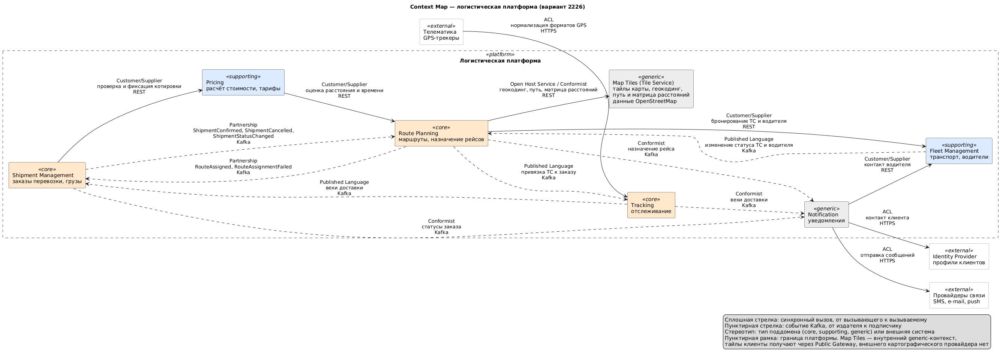
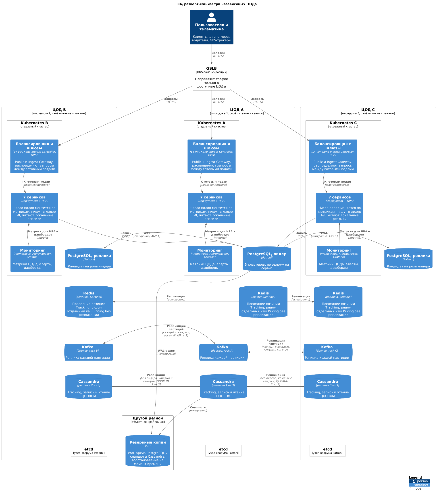

# Лабораторная работа №1. Декомпозиция системы на микросервисы

Вариант 2226: логистическая платформа, система управления перевозками, заказами и логистическими маршрутами.

## Артефакты для сдачи

| Артефакт | Файл |
|---|---|
| Context Map | [diagrams/context-map.puml](diagrams/context-map.puml) |
| Каталог микросервисов | [services.md](services.md) |
| ADR-001 | [ADR-001-decomposition.md](ADR-001-decomposition.md) |
| Схема C4 | [diagrams/c4-context.puml](diagrams/c4-context.puml); контейнеры: [обзор](diagrams/c4-container.puml), [заказ и назначение рейса](diagrams/c4-container-orders.puml), [отслеживание](diagrams/c4-container-tracking.puml), [уведомления](diagrams/c4-container-notification.puml), [карты](diagrams/c4-container-tiles.puml); [развёртывание](diagrams/c4-deployment.puml) |

Сборка картинок: `plantuml -charset UTF-8 -tpng diagrams/*.puml`

## 1. Исходные данные и допущения

Из задания: 5 млн, 5 000 RPS, 5 команд разработки. Ограничения: независимое масштабирование, доступность критичных операций 24/7, явное владение данными, возможность выделить новый сервис.

В задании нет следующих данных, поэтому приняты допущения:

- **«5 млн»** указано без единицы измерения. Считаю, что это 5 млн зарегистрированных пользователей.
- **5 000 RPS** считаю суммарным пиком на внешний API.
- **100 000 заказов в сутки**: 2 % пользователей создают заказ каждый день, пик в 10 раз выше среднего.
- **20 000 машин на линии**: один рейс занимает примерно пятую часть суток.
- **Критичные операции**: приём заказа, приём телеметрии, чтение статуса и позиции.
- **Вне варианта**: регистрация и профили клиентов вынесены во внешний Identity Provider, оплата не рассматривается.

Оценка распределения нагрузки:

| Операция | Сервис | RPS | Основание |
|---|---|---:|---|
| Приём телеметрии | Tracking | 2 000 | 20 000 машин, одна отметка в 10 секунд |
| Чтение позиции и истории | Tracking | 1 800 | страницы отслеживания у клиентов и диспетчеров |
| Заказы | Shipment | 500 | создание около 12 RPS в пик, остальное чтение |
| Расчёт стоимости | Pricing | 300 | несколько расчётов на один заказ |
| Маршруты и автопарк | Route, Fleet | 150 | работа диспетчеров |
| Тайлы карты и геокодинг | Tile Service | 200 | карта на страницах отслеживания и подсказки адреса; большая часть тайлов отдаётся из кэша браузера и шлюза |
| История и настройки уведомлений | Notification | 50 | сама рассылка идёт из Kafka и в RPS не входит |
| **Итого** | | **5 000** | |

Главный вывод: около 75 % запросов приходится на Tracking, поэтому его нельзя оставлять в одном домене отказа с заказами.

Объём хранения телеметрии: 2 000 событий/с × 150 байт ≈ 26 ГБ в сутки. За 90 дней это около 2,3 ТБ, а с тремя репликами около 7 ТБ.

## 2. Bounded contexts

| Контекст | Тип поддомена | Бизнес-возможности | Сущности |
|---|---|---|---|
| Shipment Management | core | заказы перевозки, грузы | Shipment, Cargo |
| Route Planning | core | маршруты | Route |
| Tracking | core | отслеживание | TrackingEvent |
| Pricing | supporting | расчёт стоимости | Tariff |
| Fleet Management | supporting | транспорт, водители | Vehicle, Driver |
| Notification | generic | уведомления | Notification |
| Map Tiles | generic | тайлы карты, геокодинг, расстояния (Tile Service) | MapTile, RoadGraph, Address |

Одно и то же понятие в разных контекстах значит разное, и это подтверждает границы:

- **Driver** в Fleet — сотрудник с правами и статусом, в Route — назначенный ресурс, в Notification — получатель сообщения.
- **Vehicle** в Fleet — единица автопарка с документами и грузоподъёмностью, в Tracking — только источник координат.
- **Адрес** в Shipment — место забора или доставки по заказу, в Map Tiles — запись индекса геокодинга без связи с заказами.

Map Tiles — типовой поддомен: тайлы, геокодинг и расчёт пути не отличают платформу от других, поэтому сервис собирается из готовых открытых компонентов (данные OpenStreetMap, OSRM) и работает внутри платформы, а не как внешняя система. Так у Route и страниц отслеживания нет runtime-зависимости от стороннего провайдера, его лимитов и доступности.

## 3. Context Map

Исходник: [diagrams/context-map.puml](diagrams/context-map.puml).

| Upstream | Downstream | Паттерн | Механизм | Назначение |
|---|---|---|---|---|
| Pricing | Shipment | Customer/Supplier | REST | проверка и фиксация котировки |
| Route | Pricing | Customer/Supplier | REST | оценка расстояния и времени |
| Map Tiles | Route | Open Host Service / Conformist | REST | геокодинг, путь и матрица расстояний |
| Fleet | Route | Customer/Supplier | REST, Kafka | бронирование, статусы транспорта и водителей |
| Fleet | Notification | Customer/Supplier | REST | контакт водителя |
| Shipment | Route | Partnership | Kafka | сага назначения рейса, в обе стороны |
| Route | Tracking | Published Language | Kafka | привязка транспорта к заказу |
| Tracking | Shipment | Published Language | Kafka | вехи доставки |
| Shipment, Route, Tracking | Notification | Conformist | Kafka | поводы для уведомлений |
| Телематика | Tracking | ACL | HTTPS | нормализация форматов GPS |
| Провайдеры связи, Identity Provider | Notification | ACL | HTTPS | отправка сообщений, контакт клиента |

## 4. Границы сервисов, ответственность и владение данными

На каждый контекст приходится один сервис. Route Service развёрнут двумя частями: Route API отвечает на синхронные запросы, а воркер Route Planner строит маршруты и ведёт сагу назначения; у каждой части своё описание в [каталоге](services.md).

| Сервис | Ответственность | Данные | Хранилище | Команда-владелец |
|---|---|---|---|---|
| Shipment | заказ и его жизненный цикл | Shipment, Cargo | PostgreSQL | Orders |
| Pricing | стоимость и тарифы | Tariff, Quote | PostgreSQL, кэш Redis | Pricing & Comms |
| Route (API и Planner) | маршрут и назначение рейса | Route | PostgreSQL + PostGIS | Routing |
| Fleet | учёт и бронирование ресурсов | Vehicle, Driver, Reservation | PostgreSQL | Fleet |
| Tracking | телеметрия и вехи | TrackingEvent | Cassandra, Redis | Tracking |
| Notification | доставка сообщений | Notification, NotificationPreference, NotificationTemplate, Device | PostgreSQL | Pricing & Comms |
| Tile Service | тайлы, геокодинг, расстояния | набор данных карты (только чтение) | файлы тайлов и графа, PostgreSQL + PostGIS | Routing |

Правило владения: данные меняет только сервис-владелец, общих БД и чтения чужих таблиц нет. Копии чужих данных (проекция доступности в Route, привязка «заказ — транспорт» в Tracking) строятся из событий и не считаются источником истины.

Семь сервисов распределены на пять команд. Pricing и Notification ведёт одна команда, потому что это самые простые сервисы и они не связаны между собой напрямую. Tile Service ведёт команда Routing: это её основной потребитель, а сам сервис собран из готовых компонентов и почти не требует разработки. Шлюзы и Kafka обслуживает команда Tracking как основной потребитель Kafka: отдельной платформенной команды в варианте нет.

**Точки входа.** Внешний трафик разделён по профилю нагрузки на два шлюза, у каждого свой адрес и свои экземпляры. Оба шлюза работают на Kong Ingress Controller без БД: маршруты описаны ресурсами Kubernetes, которые хранятся в git. Поэтому экземпляры не хранят состояния, и HPA добавляет их без какой-либо синхронизации (раздел 10).

| Шлюз | Клиенты | Маршруты | Пик | Масштабирование |
|---|---|---|---:|---|
| Ingest Gateway | GPS-трекеры, приложение водителя | только `POST /tracking/events` в Tracking Ingest | 2 000 RPS | по RPS телеметрии |
| Public Gateway | клиенты, диспетчеры, webhook провайдеров связи | остальной API семи сервисов, включая тайлы карты (кэшируются на шлюзе) | 3 000 RPS | по RPS и CPU |

Так всплеск телеметрии не отнимает ресурсы у приёма заказов, а сбой или неудачное обновление одного шлюза не затрагивает другой. Лимиты запросов каждый экземпляр считает локально, без общего хранилища счётчиков. При изменении числа экземпляров лимит соблюдается приблизительно, но для защиты от перегрузки этого достаточно.

**Аутентификация.** Каждый сервис проверяет токен сам, шлюзы только маршрутизируют запросы и ограничивают их частоту.

- Identity Provider выдаёт JWT: клиентам и диспетчерам при входе, водителям в приложении, а трекерам, телематике и самим сервисам — по OAuth 2.0 client credentials.
- Сервис проверяет подпись токена по открытым ключам IdP (JWKS), которые кэширует у себя. К IdP на каждый запрос он не обращается, поэтому кратковременный сбой IdP не останавливает работу.
- Права тоже проверяет сам сервис: клиент видит только свои заказы, тарифы меняет только диспетчер, отправлять телеметрию может только трекер или водитель.
- Внутренние REST-вызовы (Shipment → Pricing, Route → Fleet и другие) идут с токеном вызывающего сервиса. Запрос не считается доверенным только потому, что пришёл из внутренней сети.

Так ошибка в конфигурации шлюза или запрос в обход шлюза не открывают доступ к данным, а правила доступа к данным задаёт команда-владелец этих данных.

## 5. Основные взаимодействия

Правило выбора: синхронный REST используется, только если ответ нужен немедленно. Всё остальное передаётся событиями Kafka через Transactional Outbox.

**Жизненный цикл заказа:**

1. Клиент вводит адреса с подсказками Tile Service (`GET /geocode`) и запрашивает стоимость: `POST /quotes`. Pricing берёт расстояние из своего кэша, а при промахе получает его от Route (`POST /routes/estimate`, Route считает его через `POST /matrix` в Tile Service) и возвращает котировку.
2. Клиент создаёт заказ: `POST /shipments` с `quoteId`. Shipment проверяет котировку в Pricing, копирует цену в заказ и публикует `ShipmentConfirmed`. Статус заказа: `CONFIRMED`.
3. Route Planner получает событие и строит маршрут через Tile Service. Кандидатов он выбирает по своей проекции доступности, а затем бронирует пару в Fleet (`POST /reservations`). При ответе 409 берётся следующий кандидат.
4. Route Planner публикует `RouteAssigned`. Shipment переводит заказ в `ASSIGNED`, Tracking запоминает привязку транспорта к заказу, Notification сообщает водителю и клиенту. Если подобрать ресурс не удалось, публикуется `RouteAssignmentFailed` и заказ переходит в `ASSIGNMENT_FAILED`.
5. Телематика и приложение водителя отправляют события через Ingest Gateway в `POST /tracking/events`. Ingest пишет их в Kafka, Writer сохраняет в Cassandra и Redis, а вехи (груз забран, груз доставлен) публикует в `tracking.milestones`.
6. Shipment получает вехи и переводит заказ в `IN_TRANSIT`, затем в `DELIVERED`. По событию `ShipmentStatusChanged` со статусом `DELIVERED` Route Planner завершает рейс и освобождает бронь в Fleet.

**Отмена:** `POST /shipments/{id}/cancel` публикует `ShipmentCancelled`, после чего Route Planner отменяет рейс и снимает бронь (компенсация).

**Перепланирование:** диспетчер вызывает `POST /routes/{id}/replan` в Route API, тот сохраняет запрос и через outbox передаёт его в Route Planner по внутреннему топику `route.planning-requests`.

**Топики Kafka:**

| Топик | Издатель | Подписчики | События | Ключ |
|---|---|---|---|---|
| `shipment.events` | Shipment | Route Planner, Notification | `ShipmentConfirmed`, `ShipmentCancelled`, `ShipmentStatusChanged` | `shipmentId` |
| `route.events` | Route Planner | Shipment, Tracking, Notification | `RouteAssigned`, `RouteAssignmentFailed` | `shipmentId` |
| `route.planning-requests` | Route API | Route Planner | `ReplanRequested` | `shipmentId` |
| `fleet.events` | Fleet | Route Planner | `VehicleStatusChanged`, `DriverStatusChanged` | `vehicleId`, `driverId` |
| `tracking.positions` | Tracking Ingest | Tracking Writer | `PositionReported` | `vehicleId` |
| `tracking.milestones` | Tracking Writer | Shipment, Notification | `ShipmentPickedUp`, `ShipmentDelivered` | `shipmentId` |

**Поведение при отказах:**

| Что отказало | Что продолжает работать | Как проявляется |
|---|---|---|
| Redis Pricing | расчёт стоимости и приём заказов | кэш пуст, все расчёты идут в Route и PostgreSQL, задержка котировки растёт |
| Pricing | приём заказов, отслеживание | новых котировок нет, заказ принимается в `PRICE_PENDING`; после восстановления Shipment фиксирует цену и только тогда публикует `ShipmentConfirmed` |
| Route API | приём заказов, отслеживание, назначение рейсов | Pricing при промахе кэша считает приближённую стоимость, перепланирование недоступно |
| Route Planner | приём заказов, отслеживание, оценка стоимости | назначение откладывается, события ждут в Kafka |
| Tile Service | приём заказов, отслеживание позиций | карта на страницах не отображается, подсказок адреса нет; Pricing считает по кэшу или по прямому расстоянию; назначение рейсов откладывается |
| Fleet | приём заказов, отслеживание | назначение откладывается, Route повторяет попытку |
| Tracking | приём заказов и назначение рейсов | позиции устаревают; при отказе Ingest клиенты повторяют отправку из своего буфера |
| Notification | всё остальное | уведомления приходят с задержкой, но не теряются |
| Shipment во всех ЦОДах (например, ошибка в новой версии) | отслеживание, учёт автопарка | новые заказы не принимаются; поэтому версия выкладывается по одному ЦОДу и откатывается по росту доли ошибок |
| Ingest Gateway | весь API для клиентов и диспетчеров | позиции устаревают, трекеры копят отметки в своём буфере и отправляют повторно |
| Public Gateway во всех ЦОДах (ошибка конфигурации) | приём телеметрии | клиенты и диспетчеры не могут работать с API; конфигурация проверяется в CI и выкладывается по одному ЦОДу |
| Лидер PostgreSQL одного сервиса | все остальные сервисы | Patroni переключается на синхронную реплику, запись в этот сервис недоступна до 1 мин, данные не теряются |
| Целый ЦОД | вся система, трафик принимают два оставшихся ЦОДа | запись в БД, чей лидер был в этом ЦОДе, недоступна до 1 мин, данные не теряются |
| Kafka | чтение, приём заказов (события копятся в outbox) | назначение и уведомления останавливаются, Ingest отвечает 503 и клиенты повторяют отправку |

## 6. Обоснование декомпозиции

Границы определялись по четырём признакам: транзакционные инварианты, профиль нагрузки, причины изменений и тип хранилища.

| Вопрос о границе | Решение | Почему |
|---|---|---|
| Shipment и Cargo | вместе | груз не существует без заказа, они создаются и меняются в одной транзакции |
| Vehicle и Driver | вместе | бронь пары должна быть атомарной, нагрузка низкая |
| Route и Fleet | раздельно | Route требует CPU и часто меняет алгоритмы, Fleet — простой учёт |
| Route API и Route Planner | одно приложение, два развёртывания | общий контекст, БД и команда, но API нужен быстрый отклик, а планированию — CPU и масштабирование по отставанию Kafka |
| Tile Service и Route | раздельно | карты — типовой поддомен без знания о заказах, данные только для чтения, ими пользуются ещё и страницы отслеживания |
| Tracking и Shipment | раздельно | 4 000 против 500 RPS, неизменяемый временной ряд против транзакций, разные БД |
| Tariff и Shipment | раздельно | тарифы меняются по коммерческим причинам, а заказ хранит снимок цены, поэтому новый тариф не меняет принятый заказ |
| Notification | отдельно | типовой поддомен, работает только асинхронно, его сбой не влияет на заказ |

Как выполнены ограничения варианта:

| Ограничение | Как выполнено |
|---|---|
| Независимое масштабирование | у каждого развёртывания свой HPA и своя метрика, Ingest, Writer и Query в Tracking, API и Planner в Route масштабируются отдельно, балансировщик сам находит новые поды, внешний трафик разделён на два шлюза без состояния (разделы 4 и 10) |
| Высокая доступность | три независимых ЦОДа, у каждого хранилища копия в каждом из них (раздел 9); приём заказа и телеметрии не зависит синхронно от Route, Fleet, Tile Service и Notification; см. таблицу отказов; сбои видны в Grafana и приходят алертами (раздел 11) |
| Владение данными | своя БД, одна команда-владелец и своя проверка прав доступа у каждого сервиса |
| Выделение нового сервиса | см. раздел 8 |
| 5 команд | основной сервис у каждой команды, Pricing & Comms ведёт два простых сервиса, Routing — ещё и Tile Service из готовых компонентов |
| 5 000 RPS | чтение позиции идёт из Redis, запись буферизуется Kafka, история хранится в Cassandra с TTL |

## 7. Альтернативы

Подробное сравнение приведено в [ADR-001](ADR-001-decomposition.md).

- **Сервис на сущность (8 сервисов).** Отклонена: создание заказа и бронирование становятся распределёнными операциями, а на 5 команд приходится 8 сильно связанных сервисов.
- **Модульный монолит и отдельный Tracking.** Отклонена: остальные части масштабируются только вместе, сбой модуля затрагивает приём заказов, у четырёх команд общий релиз. Это самый дешёвый вариант и разумный промежуточный этап миграции.

## 8. Выделение нового сервиса

Возможность выделения обеспечивают три решения: каждое изменение состояния публикуется событием, Public Gateway маршрутизирует по пути, а модули внутри сервиса не используют чужие схемы БД.

**Новая возможность: Billing.** Сервис подписывается на `shipment.events`, а цена уже есть в `ShipmentConfirmed`. Существующие сервисы менять не нужно.

**Выделение из существующего сервиса: Driver Service из Fleet.** Это потребуется, если появятся смены, медосмотры и учёт режима труда и отдыха. Порядок действий (Strangler Fig):

1. Поднять новый сервис и перенести в его БД схему `driver`, которая уже изолирована.
2. Перенести публикацию `DriverStatusChanged`, формат события оставить прежним.
3. Переключить `/drivers` в Public Gateway на новый сервис.
4. Заменить общую бронь на сагу: бронь транспорта и бронь водителя становятся двумя шагами с компенсацией.

Шаг 4 и есть цена выделения, поэтому сейчас Vehicle и Driver находятся в одном сервисе.

## 9. Размещение и репликация

Чтобы критичные операции работали 24/7, система должна пережить отказ узла, стойки и целого ЦОДа. Поэтому она развёрнута в трёх независимых ЦОДах, и у каждого хранилища есть копия в каждом из них.

- **Площадки.** Три ЦОДа в одном регионе, разнесённые на десятки километров, с независимым питанием и каналами связи. Задержка между ними 1–3 мс (допущение), этого достаточно для синхронной репликации.
- **Почему три, а не два.** Автоматическое переключение требует кворума. Если две площадки теряют связь друг с другом, ни одна не может решить, что главная именно она, и возникает риск split-brain. Третий ЦОД даёт большинство 2 из 3.
- **Независимые контуры.** В каждом ЦОДе свой кластер Kubernetes, поэтому авария или неудачное обновление одного кластера не затрагивает остальные. GSLB направляет трафик только в ЦОДы, которые проходят проверку доступности.
- **Запас мощности.** Каждый ЦОД рассчитан на 50 % пиковой нагрузки, чтобы после отказа одного из них два оставшихся выдержали 5 000 RPS.

Исходник: [diagrams/c4-deployment.puml](diagrams/c4-deployment.puml).

| Компонент | Копии | Репликация | Отказ одного ЦОДа | RPO | RTO |
|---|---|---|---|---|---|
| PostgreSQL, 5 кластеров (Shipment, Pricing, Route, Fleet, Notification) | лидер и 2 реплики, по одной в каждом ЦОДе | синхронная: коммит подтверждается после записи хотя бы в одну реплику в другом ЦОДе (`ANY 1`) | Patroni по кворуму etcd повышает синхронную реплику | 0 | до 1 мин |
| Cassandra (Tracking) | RF=3, по реплике в каждом ЦОДе (ЦОД = rack) | без лидера, запись и чтение с `QUORUM` | хватает 2 реплик из 3, переключение не нужно | 0 | 0 |
| Kafka | RF=3, `broker.rack` = ЦОД, контроллеры KRaft в трёх ЦОДах | `acks=all`, `min.insync.replicas=2` | лидеры партиций переизбираются автоматически | 0 | секунды |
| Redis Tracking (последние позиции) | master и 2 реплики, Sentinel в трёх ЦОДах | асинхронная | Sentinel повышает реплику | несколько секунд, позиции восстанавливаются следующими отметками за 10 с | до 30 с |
| etcd (кворум для Patroni) | 3 узла, по одному в каждом ЦОДе | Raft | кворум 2 из 3 сохраняется | — | — |
| Redis Pricing (кэш) | по экземпляру в каждом ЦОДе | нет, это кэш | остальные ЦОДы работают со своим кэшем | не важен, кэш наполняется заново | 0 |
| Tile Service (данные карты) | полная копия в каждом ЦОДе | нет, данные только для чтения собираются из одной выгрузки OSM | остальные ЦОДы работают со своей копией | 0 | 0 |
| Шлюзы и сервисы | экземпляры в каждом ЦОДе | состояния нет | GSLB исключает ЦОД из ответов DNS | — | до 1 мин (TTL DNS) |

Запись из ЦОДов B и C идёт в лидер PostgreSQL и занимает на 1–3 мс больше, чтение идёт из локальной реплики. Лидеры пяти кластеров можно разнести по разным ЦОДам, чтобы распределить нагрузку на запись. Если откажут сразу два ЦОДа, запись в PostgreSQL остановится: подтвердить коммит будет некому. Это сделано намеренно, чтобы не терять данные, а переключение в таком случае выполняется вручную.

**Резервные копии.** Репликация не защищает от логических ошибок: ошибочный `DELETE` сразу попадает во все копии. Поэтому PostgreSQL непрерывно архивирует WAL, а Cassandra ежедневно делает снапшоты в объектное хранилище в другом регионе. Это позволяет восстановить данные на любой момент времени и пережить потерю всего региона. В таком случае данные PostgreSQL теряются не больше чем за минуту, история телеметрии — не больше чем за сутки, а восстановление занимает часы. Если этого мало, следующий шаг — асинхронная реплика в другом регионе.

## 10. Балансировка и автомасштабирование

Каждый ЦОД обслуживает свою долю трафика самостоятельно: свой кластер Kubernetes масштабирует поды и распределяет между ними запросы. Балансировка динамическая на всех уровнях: новые поды начинают получать запросы, а удалённые и неисправные перестают, без ручной настройки.

| Уровень | Чем балансируется | Как узнаёт о подах |
|---|---|---|
| Между ЦОДами | GSLB (DNS) | проверяет доступность каждого ЦОДа и исключает недоступный |
| Вход в ЦОД | L4-балансировщик с виртуальным IP (Service типа LoadBalancer) | Kubernetes обновляет список подов шлюзов |
| Шлюз → сервис | Kong Ingress Controller, алгоритм least connections | следит за Endpoints сервиса, под получает запросы после `readinessProbe`, под с ошибками временно исключается |
| Сервис → сервис (REST) | Kubernetes Service | список подов из Endpoints |

**Автомасштабирование.** Каждое развёртывание (семь сервисов, их части и оба шлюза) масштабирует свой HorizontalPodAutoscaler по метрике из [каталога сервисов](services.md): CPU, RPS или отставание consumer group в Kafka. Метрики RPS и отставания HPA получает из Prometheus через Prometheus Adapter.

- **Минимум** — 2 пода каждого развёртывания в каждом ЦОДе, чтобы перезапуск одного пода не прерывал работу.
- **Максимум** ограничен запасом мощности ЦОДа (раздел 9). Для потребителей Kafka он не больше числа партиций топика, потому что лишний потребитель простаивает.
- **ЦОДы масштабируются независимо.** При отказе одного ЦОДа его трафик уходит в два оставшихся, и их HPA добавляет поды в пределах запаса в 50 %.

## 11. Мониторинг

В каждом ЦОДе работает свой Prometheus (два экземпляра), который собирает метрики своего кластера. Сервисы и шлюзы отдают `/metrics`, для PostgreSQL, Cassandra, Redis и Kafka работают экспортеры. Так отказ одного ЦОДа не лишает мониторинга остальные, а сбор метрик не зависит от каналов между ЦОДами.

Grafana работает в каждом ЦОДе, дашборды хранятся в git, источниками данных служат все три Prometheus, поэтому из любого ЦОДа видна вся система. Alertmanager работает кластером из трёх узлов в разных ЦОДах и сам убирает дубли алертов.

| Что | Основные метрики | Пример алерта |
|---|---|---|
| Сервисы и шлюзы | RPS, доля ошибок, задержка p99 | доля ответов 5xx больше 1 % в течение 5 минут |
| Kafka | отставание consumer group, партиции без полного набора реплик | отставание Tracking Writer больше минуты |
| PostgreSQL | отставание реплик, состояние Patroni | нет синхронной реплики |
| Cassandra, Redis | задержки, доступность узлов | узел недоступен |
| Kubernetes | число подов относительно максимума HPA, CPU и память узлов | HPA упёрся в максимум |

Стек мониторинга обслуживает команда Tracking вместе со шлюзами и Kafka, а дашборды и алерты своего сервиса ведёт каждая команда.

## 12. Потенциальные проблемы

| Проблема | Последствие | Что с этим делать |
|---|---|---|
| Итоговая согласованность | клиент видит старый статус заказа | показывать промежуточные статусы, следить за отставанием потребителей |
| Логический цикл событий Shipment и Route | сага может зависнуть, логику трудно отследить | таймауты, статус `ASSIGNMENT_FAILED`, сквозной `correlationId`, при усложнении перейти на оркестратор |
| Изменение контрактов событий | ломаются сразу несколько потребителей | Schema Registry и проверка обратной совместимости в CI |
| Дубли и нарушение порядка событий | неверный статус заказа | идемпотентные потребители, ключ партиции, версия агрегата в событии |
| Kafka как общая зависимость | остановка всех асинхронных процессов | RF=3, `min.insync.replicas=2`, брокеры в трёх ЦОДах, Outbox |
| Split-brain между ЦОДами | две «главные» копии БД и расхождение данных | нечётное число площадок, решения по кворуму (etcd, KRaft, Cassandra); лидер PostgreSQL без кворума etcd сам перестаёт принимать запись |
| Межцодовые задержки | запись в PostgreSQL дольше на 1–3 мс | ЦОДы в одном регионе, лидеры кластеров распределены по ЦОДам |
| Репликация копирует ошибки | ошибочное удаление попадает во все копии | WAL-архив и снапшоты в другом регионе, восстановление на момент времени |
| Стоимость трёх ЦОДов | тройной объём хранения, запас мощности 50 % в каждом ЦОДе | это цена требования 24/7; объём телеметрии ограничен TTL 90 дней |
| Синхронная цепочка Pricing → Route → Tile Service | каскадные задержки | кэш оценок в Pricing, таймауты, circuit breaker, приближённая оценка расстояния |
| Устаревшие данные карты | новая дорога или адрес не находятся | еженедельное обновление выгрузки OSM, переключение версии с возможностью отката |
| Устаревшая проекция доступности в Route | выбор уже занятого ресурса | окончательную проверку выполняет Fleet при бронировании, ответ 409 |
| Рост хранилища телеметрии | около 7 ТБ с репликацией, горячие партиции | TTL 90 дней, архив в объектное хранилище, партиция по `vehicleId` и дню |
| Нет JOIN между контекстами | сложные сквозные отчёты | отдельная витрина, наполняемая из Kafka |
| Нет платформенной команды | перегрузка команды Tracking | управляемые Kafka и шлюзы, общие шаблоны развёртывания |
| Ошибка в конфигурации шлюза | недоступен весь API этого шлюза | декларативная конфигурация в git с проверкой в CI, выкладка по одному ЦОДу |
| HPA не успевает за резким всплеском | рост задержек, пока поднимаются новые поды | минимум подов с запасом, алерт на максимум HPA, лимиты запросов на шлюзах |
| Отказ Prometheus в ЦОДе | HPA перестаёт менять число подов по RPS и отставанию, в Grafana нет данных этого ЦОДа | два экземпляра Prometheus в ЦОДе; без метрик HPA сохраняет текущее число подов |
| Ошибка в проверке прав в одном из сервисов | доступ к чужим данным | общая библиотека проверки JWT, тесты прав доступа в CI каждого сервиса |
| Персональные данные и геопозиция водителей | риск утечки, требования 152-ФЗ | в событиях только идентификаторы, контакты запрашиваются у владельца |
